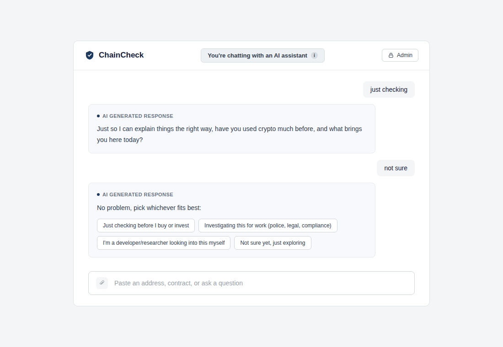

# Blockchain Scam-Detection Chat Assistant (Capstone)

> **Status: early vertical slice.** The AI pipeline logic works end to end;
> the blockchain data it reasons over is currently fake. 

## What this is

A chat assistant that answers questions about a blockchain address - scam check, info lookup, or general question - backed by evidence rather than unsupported opinion. Full design in [`SPEC.md`].

This repo currently implements one path end to end: a chat message goes through the **Business Analyser** (LLM), and if it's a scam check with no detector configured, the **Scam Checker** (LLM) reasons over evidence and returns a verdict. The evidence is fake for now - real fetchers, the
Detector Connector, and the Forensic Investigator aren't built yet.

## Setup

```bash
# LLM: local Ollama running llama3.1
ollama pull llama3.1
ollama serve

# Python deps
pip install -r requirements.txt

# Run
python cli.py "Is 0xABCDEF1234567890 a scam?"
```

## Structure

```
schema.py                          data contracts (AddressContext, DetectionResult, ...)
config.py                          LLM backend settings
fake_data.py                       stand-in blockchain evidence (no real fetchers yet)
cli.py                             entry point - runs the pipeline end to end
agents/
  business_analyser.py             scope check, request classification, input extraction
  scam_checker.py                  no-detector fallback: judges evidence, explains itself
llm_providers/
  base.py                          common LLMProvider interface
  openai_compatible.py             adapter for any OpenAI-compatible endpoint 
```

## Use Case & Expertise Extraction Flow

### Description
The assistant adapts its answers to who is asking. The Business Analyser reads the conversation and works out two things: the user's **expertise tier** (`beginner`, `intermediate`, `professional`) and their **use case** (`investment`, `investigative_legal`, `compliance_risk`). If it can't tell, it asks the user once. If the user's signals conflict (for example plain language but a compliance use case), the tier defaults to `beginner`. Once both are known they are kept for the rest of the session. The tier and use case set how the Forensic Investigator words its explanation.

### Prompt Strategy
- **Agent:** Business Analyser only (`agents/business_analyser.py`).
- **Type:** One system prompt with explicit rules and worked input-to-output examples (a few-shot style), configured as `zero_shot` in `config/app_config.json`. The model must reply with a single JSON object (`expertise_tier`, `use_case`, `needs_clarification`).
- **Why:** The signals are subtle ("wallet" vs "contract internals"), so examples keep the tiers consistent. A fixed JSON shape lets the conversation layer act on the result without parsing prose. The rules look at the whole conversation, not just the last message.

### Use Case (when it runs)
It runs on **every user message**, as part of the Business Analyser's single call (`ChatSession._run_turn` in `conversation.py`). The extraction only becomes visible to the user when the tier or use case is still unknown (`needs_clarification: true`).

### Fallback Prompt
When the first message gives too little signal, the assistant asks one combined question: *"Have you used crypto much before, and what brings you here today?"* If the answer is still too vague, it shows four quick-reply buttons instead (`_PROFILE_FALLBACK_OPTIONS`): checking before buying, investigating for work, developer/researcher, or not sure yet. The choice is sent as the next message and the Business Analyser extracts the tier and use case from it.



### Known Bugs & Issues
- **Loop after "Not sure yet":** the fallback buttons only appear once. If the user is still vague, the assistant asks the opening question again.
- **Stale buttons:** if the user types instead of clicking, the old buttons stay on screen.
- **Buttons lost on a failed request:** if the request fails, the buttons are not restored (from the Retesting log, to be re-checked).
- **No default tier for vague users:** the assistant keeps asking instead of falling back to a neutral tier.
- **Scam Checker is not tailored:** the tier and use case reach the Forensic Investigator but not the Scam Checker.
- **`address_info` requests:** tier and use case have come back null in test runs.

## WireFrames
<b>Source: </b>https://miro.com/app/board/uXjVGwYXzDk=/ <br>
Final Wireframe Designs are listed under the following subheadings: <br>
<b>Starting Page:</b> <br>
Usability Testing Pages - REFINED <br>
<ul>
  <li><b>Usability Testing Pages - REFINED:</b> Updated starting page</li>
</ul> 
<br>

<b>Chat Box Page:</b> <br>
<ul>
  <li><b>Usability Testing Pages - REFINED:</b> Updated chatbox page (Normal users)</li>
  <li><b>Usability Testing Pages - REFINED:</b> Updated chatbox page (Admin users)</li>
  <li><b>Usability Testing Pages - REFINED:</b> Fallback prompt use case --> Fallback Prompt refers to the user expertise and use case extraction </li>
  <li><b>Usability Testing Pages - REFINED (Extended):</b> Display the refinements of previous beginner, intermediate, professional use cases, including the general output data format</li>
</ul> 