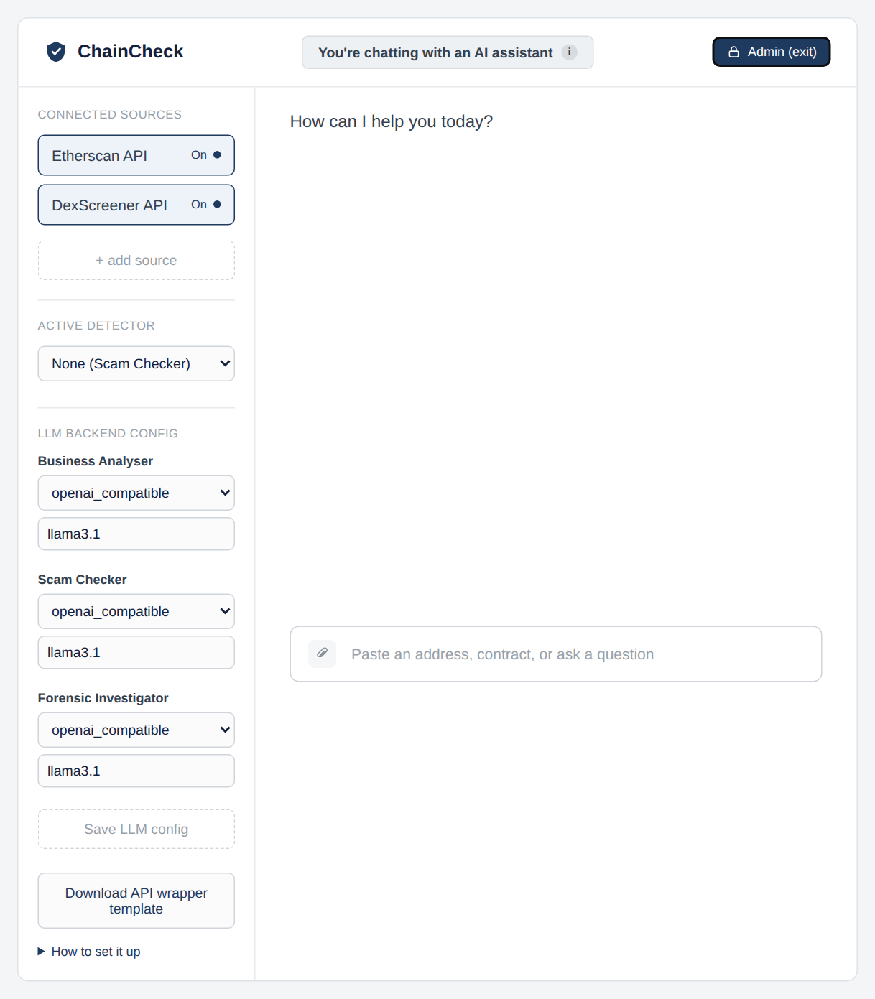
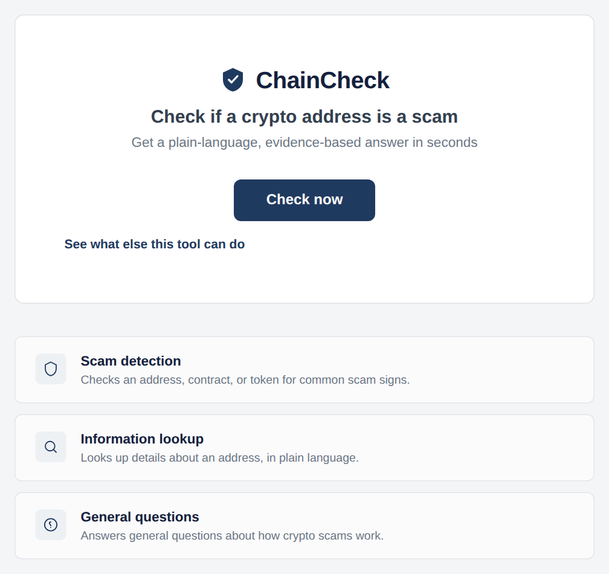
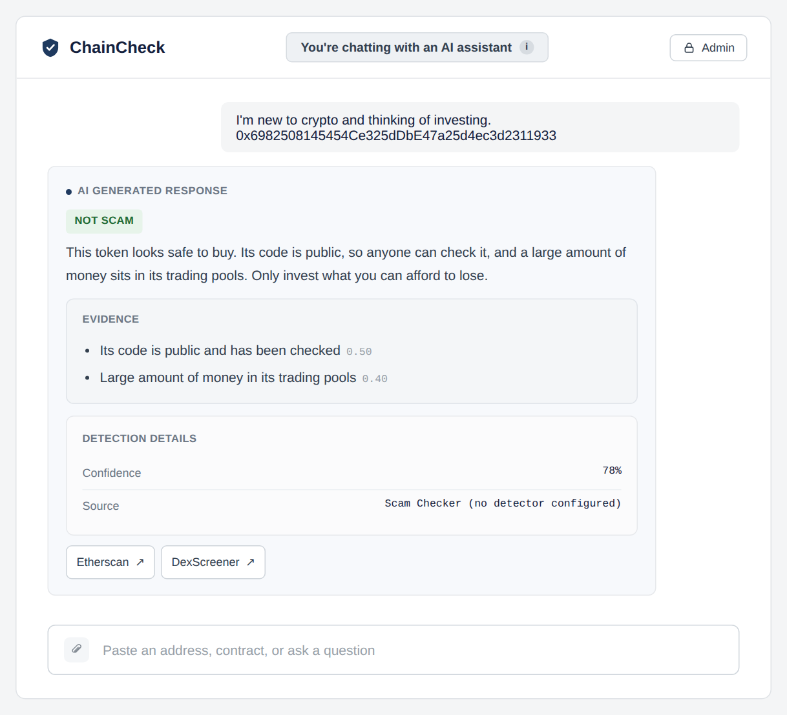

# Blockchain Scam-Detection Chat Assistant (Capstone)

## Background

**ChainCheck** is a web-based chat assistant that checks whether a blockchain address looks like a scam. It was built for RMIT researchers who want to show that an AI assistant can help human investigators spot crypto scams and fraud, outside of academic research.

Today, a scam check means visiting several sites (for example RugCheck or a honeypot detector), each covering one kind of attack, and piecing the verdict together yourself. Beginners often can't read the results, and professionals get more explanation than they need. ChainCheck puts this in one place: the user asks in plain conversation and gets an evidence-backed answer.

What it delivers:

- **Three kinds of question:** a scam check, information about an address, or a general blockchain question.
- **Answers grounded in real on-chain data**, fetched live from Etherscan and DexScreener. Every verdict comes with a confidence score, the evidence behind it and its source.
- **Bring your own detector.** The app has no detection model of its own. An admin can pick one of the pre-mapped detectors (RektRadar, EthXpose, HoneypotScan, Recon) or plug in their own with the Detector API Wrapper template. With no detector selected, an LLM Scam Checker judges the fetched evidence instead.
- **Answers that fit the user.** The assistant works out the user's experience level and why they're asking (investing, investigating or compliance), then adjusts how much jargon and detail it uses.
- **A configurable LLM backend** for each agent: local Ollama (the default, running llama3.1), OpenAI, Anthropic or Gemini.

## Setup

There are two ways to run it. **Option A (Docker)** runs everything in containers, and it's how the client deploys it. **Option B (local setup)** runs it directly with Python and is easier to develop on.

### Prerequisites

- Git (any recent version)
- Python 3.11 or newer with pip and venv (local setup only; tested with Python 3.14.3, and the Dockerfile uses 3.11)
- [Ollama](https://ollama.com/download) 0.34 or newer (local setup only; tested with 0.34.1)
- About 5 GB of disk space for the llama3.1 model, and at least 8 GB of RAM (16 GB recommended)
- A free Etherscan API key from [etherscan.io/myapikey](https://etherscan.io/myapikey)
- Internet access to Etherscan, DexScreener and the hosted detectors
- [Docker Desktop](https://www.docker.com/products/docker-desktop/) (Option A only)
- Optional: an API key for Google Gemini, OpenAI or Anthropic to use those providers, and a RektRadar key (removes the 10-minute data delay)

### Option A: Docker

Docker Compose runs two containers. One runs Ollama with llama3.1 (the 8,192-token context is already set). The other runs the app (`server.py`), which also serves the web interface at http://localhost:8000.

**To deploy:**

1. Clone the repo and check out `main` (or the release tag):

   ```bash
   git clone https://github.com/ishitalaller29/Configurable-Blockchain-Scam-Detection-Chat-Assistant.git
   cd Configurable-Blockchain-Scam-Detection-Chat-Assistant
   git checkout main
   ```

2. Copy `.env.example` to `.env` and set `ETHERSCAN_API_KEY`. Save it as `.env`, not `.env.txt`, and never commit it. The other variables are optional (see the table in Option B).
3. Build and start the containers:

   ```bash
   docker compose up --build -d
   ```

4. First time only, download the model. This downloads several GB:

   ```bash
   docker compose exec ollama ollama pull llama3.1
   ```

5. Open http://localhost:8000. To use an external detector, choose it on the Admin page.

**Health check:**

- Run `docker compose ps`. Both containers should show as running.
- Open http://localhost:8000. The chat page should load.
- Ask a test question, such as *"Is 0x6982508145454Ce325dDbE47a25d4ec3d2311933 a scam?"*, and answer the profile question. The bot should return a verdict with evidence.
- If the reply says the LLM backend (Ollama) may not be running, restart it with `docker compose restart ollama`.
- If fetcher warnings appear in `docker compose logs`, check the Etherscan key in `.env`.

**To roll back:**

1. Run `git checkout <previous release tag or commit>`.
2. Run `docker compose up --build -d`.
3. If the old version can't read the newer `config/app_config.json` or `llm_config.json`, restore those files from the same commit.

### Option B: Local setup

1. Clone the repository:

   ```bash
   git clone https://github.com/ishitalaller29/Configurable-Blockchain-Scam-Detection-Chat-Assistant.git
   cd Configurable-Blockchain-Scam-Detection-Chat-Assistant
   ```

2. Install the dependencies in a virtual environment:

   ```bash
   python3 -m venv .venv
   source .venv/bin/activate        # Windows: .venv\Scripts\activate
   pip install -r requirements.txt
   ```

3. Install Ollama, download the model and raise its context window to 8,192 tokens. The default of 4,096 silently cuts off the Scam Checker's prompt. In the Ollama app, open **Settings**, set **Context length** to 8k and restart it. Without the app, start the server with the variable set:

   ```bash
   ollama pull llama3.1
   OLLAMA_CONTEXT_LENGTH=8192 ollama serve   # only if you're not using the app
   ```

4. Configure the environment variables: copy `.env.example` to `.env` and fill in what you need.

   | Variable | Needed? | Where to get it / what it does |
   |---|---|---|
   | `ETHERSCAN_API_KEY` | Yes | Free key from [etherscan.io/myapikey](https://etherscan.io/myapikey). Used by every on-chain lookup. |
   | `GEMINI_API_KEY`, `OPENAI_API_KEY`, `ANTHROPIC_API_KEY` | Only for that provider | From Google AI Studio, platform.openai.com or console.anthropic.com. Only needed if an agent is switched to `gemini_native`, `openai_native` or `anthropic_native`. |
   | `REKTRADAR_API_KEY` | No | From rektradar.io. Without it, RektRadar is called anonymously, with data about 10 minutes behind. |
   | `LLM_PROVIDER`, `LLM_MODEL` | No (CLI only) | Backend for `cli.py`: `openai_compatible` (default), `openai`, `anthropic` or `gemini`, plus a model name. The web app ignores them. |
   | `OLLAMA_BASE_URL`, `OLLAMA_MODEL` | No | Defaults: `http://localhost:11434/v1` and `llama3.1`. |
   | `ACTIVE_DETECTOR` | No | Overrides `active_detector` in `config/app_config.json`, e.g. `rektradar_mock`. `none` means the Scam Checker. |
   | `DEXSCREENER_CACHE_PATH` | No | Where the liquidity fetcher keeps its small cache file. Default: `dexscreener_liquidity_cache.json`. |

5. Point the agents at your local Ollama. `llm_config.json` is set up for Docker (`http://ollama:11434/v1`), and that address doesn't work outside Docker. Open `llm_config.json` and change all three `base_url` values to `http://localhost:11434/v1`. Change them back before you use Docker again, and don't commit this change.

6. Run the project locally:

   ```bash
   uvicorn server:app --port 8000
   ```

   Then open http://localhost:8000/. For the terminal version, use `cli.py` instead:

   ```bash
   python cli.py "Is 0xdAC17F958D2ee523a2206206994597C13D831ec7 a scam?"
   ```

#### Verifying it worked

Times below assume Ollama and the model are already installed.

- http://localhost:8000/ redirects to the ChainCheck starting page, and its **Check now** button leads to the chat.
- *"What is a rug pull? I'm new to crypto and considering purchasing my first token."* gets an explanation in plain language in about 25 seconds.
- *"I'm new to crypto and would like to invest. Is 0xdAC17F958D2ee523a2206206994597C13D831ec7 a scam?"* (USDT) gets **Not scam** with about 90% confidence, three evidence items (verified source, diverse transaction history, high liquidity) and *Source: Scam Checker*, in about 2 minutes. If your message doesn't say how familiar you are with crypto, the assistant asks first. Answer that and the check continues.
- With Admin mode on (passphrase `admin`) and the active detector set to **HoneypotScan**, asking about `0x1f9840a85d5aF5bf1D1762F925BDADdC4201F984` (UNI) gives a **Not scam** answer (100% confidence in our test run) and *Source: Configured detector (HoneypotScan)*. The wording of the explanation varies from run to run.
- If every chat fails and the server log shows `APIConnectionError: Connection error`, step 5 was skipped or Ollama isn't running. If verdicts cite evidence that isn't in the data, check Ollama's context length (step 3).

## Structure

The Detector API Wrapper template has its own repo: [Configurable-Blockchain-Scam-Detection-Chat-Assistant-Detector-API-Wrapper](https://github.com/s3785335/Configurable-Blockchain-Scam-Detection-Chat-Assistant-Detector-API-Wrapper). `.env`, `dexscreener_liquidity_cache.json` and `config/added_sources.json` (detectors added with "+ add source") are created at runtime and git-ignored.

```
server.py                       FastAPI app: chat + admin API, serves the web frontend at /
cli.py                          terminal version of the chat (one question or interactive)
conversation.py                 ChatSession: runs each turn and keeps the chat history
schema.py                       Pydantic data contracts (AddressContext, DetectionResult, ...)
config.py                       builds each agent's LLM backend from llm_config.json and .env
config_loader.py                reads config/app_config.json (detectors, data sources)
raw_data.py                     collects the raw identifiers behind a reply for the UI
llm_config.json                 LLM backend per agent (set from the Admin view)
.env.example                    every environment variable the app reads; copy to .env
requirements.txt                Python dependencies
run.py                          starts the web app on port 8000 (what Docker runs)
start.sh                        one-click start for macOS/Linux (Docker)
start.bat                       one-click start for Windows (Docker)
stop.bat                        one-click stop for Windows
Dockerfile                      image for the app container (runs run.py)
docker-compose.yml              Ollama + app containers
agents/
  business_analyser.py          scope check, request type, input, expertise tier + use case
  scam_checker.py               no-detector path: judges the fetched evidence, explains itself
  forensic_investigator.py      explains a non-LLM detector's result in plain language
  jargon.py                     how much jargon to use per expertise tier
fetchers/                       on-chain data (see fetchers/README.md)
  etherscan.py                  shared Etherscan API V2 helper (key, rate limit, retries)
  contract_fetcher.py           contract source, verification status and creator
  tx_history_fetcher.py         the newest 100 transactions
  token_fetcher.py              token transfers and estimated balances
  tx_hash_resolver_fetcher.py   turns a transaction hash into an address
  dexscreener.py                shared DexScreener API helper
  liquidity_fetcher.py          DEX liquidity pools and sudden liquidity drops
  context_builder.py            runs the fetchers, caches 10 min, records what failed
  fetcher_output.py             builds the AddressContext for one request
detector/                       Detector Connector (see detector/README.md)
  connector.py                  calls the active detector over HTTP
  mapping.py                    maps a detector's raw JSON to a DetectionResult
  validator.py                  checks detector configs and their mapping files
  wrapper_source.py             adds a running Detector API Wrapper ("+ add source")
config/
  app_config.json               agents, data sources, detectors + mappings, active detector
llm_providers/
  base.py                       common LLMProvider interface
  openai_compatible.py          any OpenAI-compatible endpoint, including Ollama
  openai_native.py              OpenAI
  anthropic_native.py           Anthropic
  gemini_native.py              Google Gemini
frontend/                       plain HTML/CSS/JS, no build step
  starting-page/                landing page
  chatbox-page/                 chat page and Admin view
mock_detector/
  app.py                        local fake detector on port 9000, for demos
downloads/                      Detector API Wrapper template zip, served by the Admin view
docs/images/                    images used in this README
```

## Use Case & Expertise Extraction Flow

### Description
The assistant adapts its answers to who is asking. The Business Analyser reads the conversation and works out two things: the user's **expertise tier** (`beginner`, `intermediate`, `professional`) and their **use case** (`investment`, `investigative_legal`, `compliance_risk`). If it can't tell, it asks the user once. If the user's signals conflict (for example plain language but a compliance use case), the tier defaults to `beginner`. Once both are known they are kept for the rest of the session. The tier and use case set how the Forensic Investigator words its explanation.

### Prompt Strategy
- **Agent:** Business Analyser only (`agents/business_analyser.py`).
- **Type:** One system prompt with explicit rules and worked input-to-output examples (a few-shot style), configured as `zero_shot` in `config/app_config.json`. The model must reply with a single JSON object (`expertise_tier`, `use_case`, `needs_clarification`).
- **Why:** The signals are subtle ("wallet" vs "contract internals"), so examples keep the tiers consistent. A fixed JSON shape lets the conversation layer act on the result without parsing prose. The rules look at the whole conversation, not just the last message.

### Use Case (when it runs)
It runs on **every user message**, as part of the Business Analyser's single call (`ChatSession._run_turn` in `conversation.py`). The extraction only becomes visible to the user when the tier or use case is still unknown (`needs_clarification: true`).

### Fallback Prompt
When the first message gives too little signal, the assistant asks one combined question: *"Have you used crypto much before, and what brings you here today?"* If the answer is still too vague, it shows four quick-reply buttons instead (`_PROFILE_FALLBACK_OPTIONS`): checking before buying, investigating for work, developer/researcher, or not sure yet. The choice is sent as the next message and the Business Analyser extracts the tier and use case from it.


### Known Bugs & Issues
- **Loop after "Not sure yet":** the fallback buttons only appear once. If the user is still vague, the assistant asks the opening question again.
- **Stale buttons:** if the user types instead of clicking, the old buttons stay on screen.
- **Buttons lost on a failed request:** if the request fails, the buttons are not restored (from the Retesting log, to be re-checked).
- **No default tier for vague users:** the assistant keeps asking instead of falling back to a neutral tier.
- **Scam Checker is not tailored:** the tier and use case reach the Forensic Investigator but not the Scam Checker.
- **`address_info` requests:** tier and use case have come back null in test runs.

## Frontend

The frontend is plain HTML, CSS and JavaScript in `frontend/` (no framework or build step), served by `server.py`. It has two pages: a starting page and the chat page. Admin tools live in a sidebar on the chat page.

### Admin View



**Opening it.** The **Admin** button in the top bar opens a passphrase dialog. A correct passphrase opens the left sidebar and the button changes to **Admin (exit)**; clicking that hides the sidebar again. A wrong passphrase shows an error and keeps the sidebar closed, and Cancel or Esc closes the dialog.

**What can be configured**

| Setting | What it does |
|---|---|
| Connected sources | Turns Etherscan and DexScreener on or off as data sources. At least one has to stay on. Saving starts a fresh conversation. |
| + add source | Adds an external detector. Enter a name and the address of a running Detector API Wrapper (for example `http://localhost:8002`). The server checks the wrapper is up and has a detector set up, then saves it on that machine. |
| Active Detector | Chooses who answers scam checks. "None (Scam Checker)" means the app's own Scam Checker decides. Picking a detector means it decides and the Forensic Investigator explains its evidence. Changing it starts a fresh conversation. |
| LLM Backend Config | Sets the provider (`openai_native`, `anthropic_native`, `gemini_native`, `openai_compatible`) and model for each of the three agents: Business Analyser, Scam Checker and Forensic Investigator. Saving applies at once, with no restart. The panel marks a provider that isn't wired up yet. |
| Download API wrapper template | Downloads the Detector API Wrapper project, with a six-step "How to set it up" guide. The ZIP must be placed at `downloads/detector-api-wrapper-template.zip` on the server. |

**Why it is admin only.** The client specified that regular users should only see the chat. These settings change which services the app calls, what it costs and which model writes every answer, so a change affects every user's results. API keys stay on the server and are never sent to the browser.

**The admin lock (current decision).** The passphrase is hardcoded in `frontend/chatbox-page/script.js` as `ADMIN_PASSPHRASE` (currently `admin`). The client suggested a shared passphrase, and the technical advisor meeting confirmed it as the simplest acceptable approach, because real accounts are out of scope for this project. It only keeps the panel out of ordinary users' sight. It is checked in the browser, and the `/admin/*` endpoints on the server are not protected, so it is **not real security**. Before any real use it should be replaced by server-side sign-in and protected admin endpoints.

### Design Decisions

**Colour scheme.** Navy (`#1f3a5f`, `#14213d`) with white and light grey. Our first mockups were green with a hexagon pattern, and usability testers found them unserious for an audience of investors, investigators and compliance staff, so we moved to a calm, professional palette. Verdict tags use muted green (Not scam) and muted red (Scam). "Insufficient evidence" is neutral grey on purpose: amber would read as a risk signal when the honest answer is "we don't know". Typography is Arial, with monospace for hashes and addresses so they can be read and copied exactly.

**Output format.** Each verdict reply has the same parts, in the same order, so users learn where to look:
- A verdict tag, then the explanation in plain text. The jargon level follows the user's expertise tier, and defined terms link to a glossary.
- An **Evidence** box, then **Detection details** (confidence, risk type, and whether the result came from a configured detector or the Scam Checker's own reasoning).
- **Source pills** at the end. The Etherscan and DexScreener pills open the address page.
- A **Raw evidence** block (transaction hashes, addresses, block hashes, each with its source) for professional users only. It shows when the tier is professional or the use case is investigative or compliance. It sits in its own block so investigators can tell what the data sources returned from what the AI said about it.
- Gaps are shown, not hidden: "Insufficient evidence", and a note listing any data that could not be checked.

**Screen layout.** One chat column with the input fixed at the bottom. A badge in the header says "You're chatting with an AI assistant", because testers could only infer this from the layout. The starting page has no address box: the client wanted regular users to go straight into the chat. Admin tools sit in a sidebar that only appears after unlocking, so the normal view stays uncluttered. The paperclip is for file attachments only (it was earlier mistaken for an API source menu), and currently says attachments are not available.

**Accessibility.** Status is always shown as text as well as colour. Controls are real buttons and links, toggles use `aria-pressed`, and the dialog uses `role="dialog"`, closes with Esc and returns focus to the Admin button. Error and status messages use `role="alert"` or `role="status"`. Text is dark on light backgrounds for contrast. No formal accessibility audit has been run.

### Starting & Chat Box Pages



The starting page says what the tool does in one line, with three cards for its main abilities. Both buttons lead to the chat.

| Control | What it does |
|---|---|
| Check now | Opens the chat page |
| See what else this tool can do | Opens the chat page |



The chat page is the main screen. The reply above is a beginner-level answer: plain words, Evidence box, Detection details and source pills.

| Control | What it does |
|---|---|
| ChainCheck logo | Returns to the starting page |
| Admin | Opens the passphrase dialog (see Admin View) |
| Paperclip | Shows that attachments are not available yet |
| Input box (Enter) | Sends the message |
| Quick-reply buttons | Send that option as the next message |
| Source pills | Open the address on Etherscan or DexScreener in a new tab |
| Definitions pill | Shows the glossary terms used in the reply |
| Copy (Raw evidence) | Copies that hash or address |

## WireFrames
<b>Source: </b>https://miro.com/app/board/uXjVGwYXzDk=/ <br>
Final Wireframe Designs are listed under the following subheadings: <br>
<b>Starting Page:</b> <br>
Usability Testing Pages - REFINED <br>
<ul>
  <li><b>Usability Testing Pages - REFINED:</b> Updated starting page</li>
</ul> 
<br>

<b>Chat Box Page:</b> <br>
<ul>
  <li><b>Usability Testing Pages - REFINED:</b> Updated chatbox page (Normal users)</li>
  <li><b>Usability Testing Pages - REFINED:</b> Updated chatbox page (Admin users)</li>
  <li><b>Usability Testing Pages - REFINED:</b> Fallback prompt use case --> Fallback Prompt refers to the user expertise and use case extraction </li>
  <li><b>Usability Testing Pages - REFINED (Extended):</b> Display the refinements of previous beginner, intermediate, professional use cases, including the general output data format</li>
</ul> 